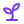

<!-- readme-standard: 2026-11-02 -->

# 🌎 PIR® Public Relations (PR Committee)

*How the fellowship shows up in the world: social media, press and outreach, brand, podcast and newsletter.*

 **You are here:** PIR® › source `public-relations` (private) → twin `public-relations-public` (public, listed paths only) · `main` is the working branch

##  TL;DR

1.  **What this is.** The committee's home. We keep anonymity at the level of press, radio and film.
2.  **Who it is for.** Anyone who needs a post, a flyer, design help or a press answer, and anyone who wants to serve.
3.  **Do this first.** Type `/pr` in [PIR®'s Discord](https://discord.gg/MyprTq8w95), or use the [web helpdesk](https://psychedelicsinrecovery.github.io/alex-desk-public/portal.html#pr).

> 🌐 [PR Committee page](https://service.psychedelicsinrecovery.org/pr-committee/) · 📣 [Public Relations](https://www.psychedelicsinrecovery.org/public-relations/) ·
> 🎫 Need PR's help? Type `/pr` in [PIR®'s Discord](https://discord.gg/MyprTq8w95) or use the [web helpdesk](https://psychedelicsinrecovery.github.io/alex-desk-public/portal.html#pr)

**Attraction, not promotion.** The Public Relations Committee of **Psychedelics In Recovery™ (PIR®)** shapes how the
fellowship shows up in the world: social media, press and outreach, brand assets, the 📻 Integration Radio podcast
and the 📰 De Vine News newsletter.

## 📣 What PR does
| | |
|---|---|
| 📱 **Social media** | PIR® on Instagram, Facebook, YouTube, TikTok, LinkedIn, Spotify and more |
| 📰 **Press & outreach** | Answering press questions and sharing PIR® with professionals and communities |
| 🎨 **Brand** | Logos and usage guidance: [brand-assets](https://github.com/psychedelicsinrecovery/brand-assets) |
| 📻 **Integration Radio** | PIR®'s podcast: https://integrationradioapirpodcast.buzzsprout.com/2588998/follow |
| 🗞️ **De Vine News** | The newsletter, made by the Newsletter subcommittee: https://www.psychedelicsinrecovery.org/newsletter/ |

## 🕊️ Anonymity in public
We keep anonymity at the level of press, radio and film: no full names or faces without explicit consent, and nothing
that identifies a member. Stories are shared with the storyteller's OK, and only the way they choose.

## 🎫 Working with PR
- **Posts, flyers, design help, press questions, newsletter submissions:** open a `/pr` ticket. A private thread opens
  with the PR team, with an ID like `PR-12`.
- **Using the PIR® or Psychedelics In Recovery™ marks in something new?** Ask first with `/pr`.
- **Portal:** https://psychedelicsinrecovery.github.io/pr-desk-public/

## 🙋 Serve with PR
Writers, designers, editors, video and audio helpers and social-media volunteers are always welcome. Say hello in the
🌎public-relations channel, or tap **Serve with PR** there.

## 🗄️ The private side
This public repository is a filtered copy of the PR Committee's private working repo, published automatically by an
allowlist (only this README and its pictures in `assets/`, for now). Proposals and briefs stay private until the committee shares them.

##  Suggest a change

Noticed something? Type `/pr` in [PIR®'s Discord](https://discord.gg/MyprTq8w95) or use the [web helpdesk](https://psychedelicsinrecovery.github.io/alex-desk-public/portal.html#pr); the PR team reads it. Members with access may send a pull request against `main` here, and a person with the role merges; the public mirror takes none.

## 📄 License
- 💻 **Code:** MIT, see [`LICENSE`](LICENSE)
- 📝 **Written content** (docs, changelog and library prose, READMEs): CC BY-SA 4.0, see [`LICENSE-CONTENT`](LICENSE-CONTENT)
- 🏷️ **Names, logos and marks:** not covered by either license, see [`TRADEMARKS.md`](TRADEMARKS.md)

PIR® and Psychedelics In Recovery™ are marks of Psychedelics In Recovery, a 501(c)(3) nonprofit.

The front door follows the living [README standard](https://github.com/drasticstatic/my-template/blob/main/README-STANDARD.md). Copy it, improve it.
